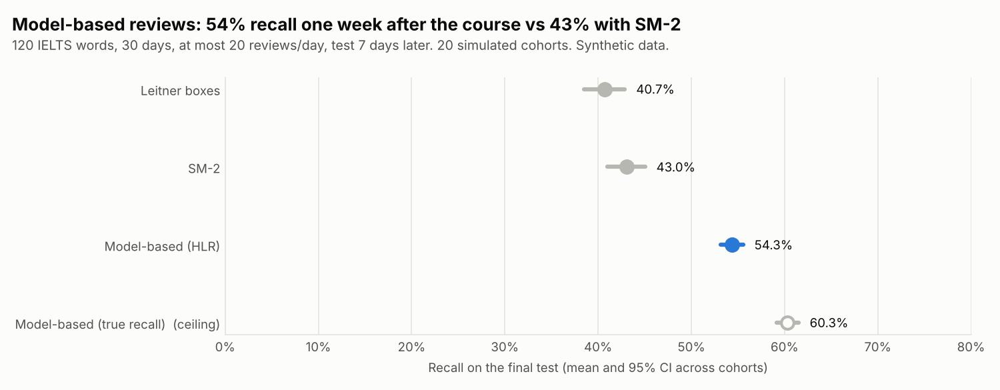
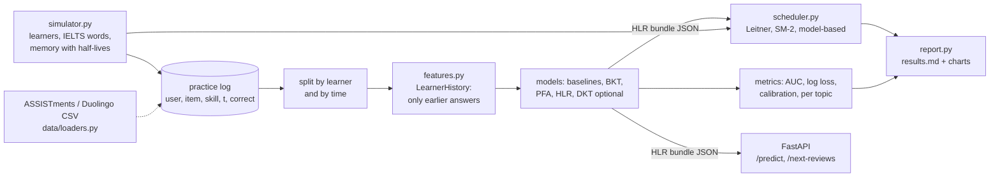
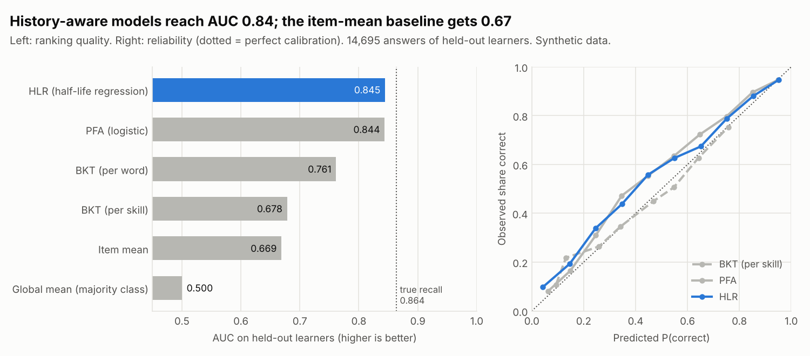

# Knowledge Tracing + Spaced Repetition for Vocabulary


This project predicts whether a learner will remember an English word the next time they see it,
then uses those predictions to choose which words to review each day. It compares four recall
models (Bayesian Knowledge Tracing, a PFA-style logistic model, half-life regression, and an
optional small GRU) against two baselines on held-out learners. Then it runs a simulated 30-day
IELTS vocabulary course and checks if model-based scheduling beats Leitner boxes and SM-2 under
the same daily review budget. All data is **synthetic**, from a documented learner simulator.
Loaders for ASSISTments and Duolingo data are included so the real data can be dropped in.

**What this project shows**

- Knowledge tracing written from scratch: BKT with EM (scaled forward-backward in numpy),
  half-life regression with an analytic gradient, and a test for each piece of maths.
- Honest evaluation: split by learner *and* by time, two baselines, a "true recall" ceiling from
  the simulator, calibration as well as AUC, and a test that flips the test labels and checks
  that the fitted model does not change.
- A decision made from predictions: a review scheduler, measured in a paired simulation over
  20 cohorts with confidence intervals and a budget sensitivity check.
- A small, stateless FastAPI service (`/predict`, `/next-reviews`) that uses the same feature
  code and the same review rule as the simulation.



## Problem

I taught English and IELTS for years. Learners forget most new words within days unless they
review them, and nobody has time to review everything. A review is worth most when a word is
*about* to be forgotten: too early wastes time, too late means learning it again. So two
questions matter for a vocabulary app such as HaiEduTech's:

1. **Prediction:** what is the chance this learner recalls this word right now?
2. **Decision:** with only 20 reviews today, which 20 words should they see?

## Architecture



Step-by-step code walkthrough: **[docs/how-it-works.md](docs/how-it-works.md)**.
Why each choice was made: **[docs/decisions.md](docs/decisions.md)**.

## Quick start

```bash
python -m venv .venv && source .venv/bin/activate
make install          # pip install -e ".[dev]"
make check            # ruff, mypy, pytest with the coverage gate
ktrace report         # whole study: docs/results.md + docs/img/*.png (about 2 minutes)
ktrace train          # fit on synthetic data, save artifacts/model.json
ktrace serve          # API on http://127.0.0.1:8000/docs
```

```bash
curl -X POST localhost:8000/next-reviews -H 'content-type: application/json' -d '{
  "now": "2026-03-10T18:00:00Z", "budget": 3,
  "history": [
    {"item_id": "envi_000", "skill_id": "environment", "timestamp": "2026-03-01T18:00:00Z", "correct": true},
    {"item_id": "envi_001", "skill_id": "environment", "timestamp": "2026-03-01T18:01:00Z", "correct": false},
    {"item_id": "envi_000", "skill_id": "environment", "timestamp": "2026-03-04T18:00:00Z", "correct": true},
    {"item_id": "heal_002", "skill_id": "health", "timestamp": "2026-03-08T18:00:00Z", "correct": true}]}'
```

```json
{"now": "2026-03-10T18:00:00Z", "candidates": 3,
 "items": [{"item_id": "heal_002", "skill_id": "health", "predicted_recall": 0.804},
           {"item_id": "envi_000", "skill_id": "environment", "predicted_recall": 0.762},
           {"item_id": "envi_001", "skill_id": "environment", "predicted_recall": 0.212}]}
```

Words are listed closest to the 0.85 target first. `/predict` takes the same history plus a list
of `(item, time)` queries and returns P(recall) for each, using only events before each query.

**Real data.** `ktrace train --data skill_builder_data.csv --format assistments` (ASSISTments
2009-2010 skill-builder) or `--format duolingo` (the HLR traces of Settles & Meeder, 2016).
`data/loaders.py` explains how each file is mapped and what is lost on the way (ASSISTments has
no usable timestamps, so time features mean little there).

## Results (synthetic data)

From `ktrace report` ([docs/results.md](docs/results.md)): 119,653 answers from 400 simulated
learners; models fit on 280 learners before day 18.3 and are scored on 14,695 later answers of
120 held-out learners.

| Model | AUC | Log loss |
| --- | --- | --- |
| Global mean (majority class) | 0.500 | 0.690 |
| Item mean | 0.669 | 0.642 |
| BKT (per skill) | 0.678 | 0.634 |
| BKT (per word) | 0.761 | 0.662 |
| PFA (logistic) | 0.844 | **0.490** |
| **HLR (half-life regression)** | **0.845** | 0.497 |
| True recall (simulator ceiling) | 0.864 | 0.452 |



Scheduling: 30 learners per cohort, 30 days, 120 words (5 new a day), at most 20 reviews a day,
final test 7 days after the course, 20 cohorts.

| Scheduler | Final-test recall (95% CI) | Reviews used per day |
| --- | --- | --- |
| Leitner boxes | 0.407 (0.385 to 0.429) | 15.6 |
| SM-2 | 0.430 (0.410 to 0.451) | 15.6 |
| **Model-based (HLR, target 0.85)** | **0.543 (0.531 to 0.556)** | 17.4 |
| Model-based with true recall (ceiling) | 0.603 (0.591 to 0.615) | 16.8 |

**How to read this honestly**

- PFA and HLR are almost tied and both close to the ceiling (0.864 AUC). BKT barely beats the
  item-mean baseline: it has no idea of time, and the simulated memory decays with time.
- Model-based scheduling gains +0.113 recall over SM-2 (paired 95% CI +0.104 to +0.122). Part of
  this is planted. The simulator's memory has the same shape that HLR assumes. Its spacing effect
  rewards a review when a word is partly forgotten, which fixed intervals do not track per
  learner and word. Expect a much smaller gain on real learners.
- The gain is not only "more reviews": at a budget of 10 a day every scheduler uses 8.8 to
  9.3 reviews, and the model-based one still leads (0.356 vs 0.250 for SM-2).
- HLR is 0.060 below the true-recall ceiling. It predicts recall a little too low in the middle
  range (see the reliability chart), so it reviews some words earlier than needed.

## Design decisions (summary)

- **One feature class for training, simulation and API** (`LearnerHistory`), computed before
  the answer is seen: leakage-free by construction, and tested.
- **Split by learner and by time**; test learners' early answers are context only.
- **BKT per skill as asked, plus BKT per word** to show why one skill per topic is a poor fit
  for vocabulary.
- **HLR with log loss on 0/1 answers** and probabilities kept in [0.01, 0.99].
- **Model-based rule: review words just below 0.85, closest first**; the same function serves
  the API.
- **Paired simulation:** every scheduler meets the same simulated learners with the same luck.
- **DKT is optional** (`.[deep]`), so CI stays fast.

Full reasoning and costs: [docs/decisions.md](docs/decisions.md).

## Project layout

```
src/ktrace/
  simulator.py   the synthetic world: learners, IELTS words, half-life memory
  data/          loaders.py (ASSISTments, Duolingo, canonical CSV), split.py
  features.py    LearnerHistory: features from earlier answers only
  models/        baselines.py, bkt.py, pfa.py, hlr.py, dkt.py (optional)
  metrics.py     AUC, log loss, calibration, per-topic AUC
  benchmark.py   fit all models, score held-out learners
  predictor.py   HLR bundle (JSON) + online predictor for one learner
  scheduler.py   Leitner, SM-2, model-based; course simulation and CIs
  api.py         FastAPI: /predict, /next-reviews, /health
  report.py      docs/results.md and the two charts
  cli.py         ktrace generate | train | report | serve
docs/            how-it-works, decisions, results, charts
tests/           42 test cases (+1 DKT test skipped without torch), 98% coverage
```

## Testing and quality

- **42 test cases** from 35 test functions (one more, for DKT, runs when torch is installed):
  BKT update on a hand example, EM never lowering the likelihood and recovering known parameters, HLR recall falling with
  time and halving at the half-life, the HLR gradient against finite differences, features that
  ignore the future, the learner/time split, flipped test labels leaving the model unchanged,
  every required model beating both baselines, the planted spacing effect, Leitner and SM-2
  rules, every scheduler respecting the budget, determinism with a seed, the API contract, and
  both dataset loaders on small fixtures.
- **CI** (GitHub Actions): ruff lint and format, mypy, pytest with an 80% coverage gate, Docker
  image build. `pre-commit install` runs the same checks locally.

## What I'd do next

- Run the study on the Duolingo HLR traces and on ASSISTments, and report those numbers next to
  the synthetic ones.
- Calibrate HLR (for example isotonic regression on a validation month) and see if it closes
  part of the 0.06 gap to the true-recall scheduler.
- Try the review rule "lowest predicted recall first" and other targets (0.7 to 0.95).
- Add a forgetting parameter to BKT and compare with HLR on time-stamped data.
- Pilot with real HaiEduTech learners: an A/B test with retention measured on a delayed quiz.

Data: synthetic, generated by `ktrace.simulator`. The loaders support
[ASSISTments 2009-2010](https://sites.google.com/site/assistmentsdata/) and the
[Duolingo HLR dataset](https://github.com/duolingo/halflife-regression); check their licences
and terms of use before downloading. Licence of this code: MIT.
